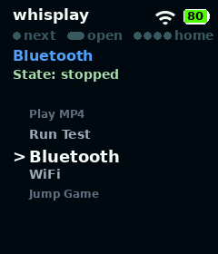
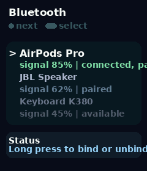
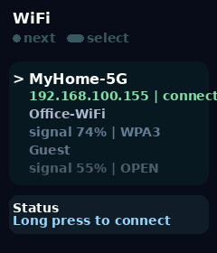

[English](README.md) | [中文](README_CN.md)

# PiSugar Whisplay Hat Driver

## Project Overview

This project provides comprehensive driver support for the **PiSugar Whisplay Hat**, enabling easy control of the onboard LCD screen, physical buttons, LED indicators, and audio functions.

**Supported Platforms:**
- Raspberry Pi (all models with 40-pin header)
- [Orange Pi Zero 2W](http://www.orangepi.org/html/hardWare/computerAndMicrocontrollers/details/Orange-Pi-Zero-2W.html) (H618; official Debian Bookworm 1.0.2 / Linux 6.1.31)
- [MangoPi MQ Quad](https://linux-sunxi.org/MangoPi_MQ-Quad) (Allwinner H616; tested on Orange Pi OS 3.0.8 / Linux `5.16.17-sun50iw9` with ES8389 and V1 WM8960)
- [Orange Pi Zero 3W](http://www.orangepi.org/html/hardWare/computerAndMicrocontrollers/details/Orange-Pi-Zero-3W.html) (Allwinner A733; official Debian Bookworm 1.0.0 / Linux 6.6.98)
- [Radxa ZERO 3W](https://radxa.com/products/zeros/zero3w/) (RK3566)
- [Radxa Cubie A7Z](https://radxa.com/products/cubie/a7z/) (Allwinner A733)

More Details please refer to [Whisplay HAT Docs](https://docs.pisugar.com/docs/product-wiki/whisplay/intro)

---

### **💡 Bus Information Tip 💡**

The device utilizes **I2C, SPI, and I2S** buses. The **I2S and I2C buses** are used for audio and will be enabled automatically during driver installation. 

---

### Installation

After cloning the project, run the unified installer entry:

```bash
git clone https://github.com/PiSugar/Whisplay.git --depth 1
cd Whisplay
sudo bash install_driver.sh
sudo reboot
```

When Raspberry Pi boots with a programmed PiSugar Whisplay HAT EEPROM, the installer leaves `whisplay-soundcard` overlay loading to the EEPROM and removes any legacy manual `dtoverlay=whisplay-soundcard` config.

#### MangoPi MQ Quad compatibility

MangoPi MQ Quad support has been tested on the Orange Pi OS 3.0.8 Bullseye image with vendor kernel `5.16.17-sun50iw9`, using both ES8389 and V1 WM8960 Whisplay HATs. This image may identify the board as Orange Pi Zero2; use `sudo bash script/install_mangopi_mq_quad.sh` to explicitly select the MangoPi installer. Reboot after installation to load the module and overlay; do not hot-unbind the codec.

- LCD, backlight, RGB LED, buttons, and the daemon desktop/app switching are supported. Jump Game and Flappy Bird were tested with sound enabled through repeated launch/exit cycles.
- Real speaker playback and both microphone channels were verified, including simultaneous playback/capture, repeated device opens, and recovery after reboot. An external USB microphone independently confirmed speaker output; validation is not limited to DMA or digital loopback.
- Audio uses the `whisplaysound` ALSA card at 48 kHz with two 32-bit I2S slots. S16_LE, S24_LE, and S32_LE SoC loopbacks passed channel mapping and tone-frequency checks. The HAT speaker is mono; stereo mapping is checked on the digital path.
- Keep `libasound2-plugins` installed (included by the MangoPi installer) for game audio resampling. Install the optional daemon separately with `sudo bash daemon/install_whisplay_daemon_service.sh`.
- V1 WM8960 requires `snd-soc-wm8960`, which this vendor kernel does not include. The installer builds it when missing; matching kernel headers must be available at `/lib/modules/$(uname -r)/build`. The machine driver uses the V1 HAT's 24 MHz oscillator with WM8960's automatic PLL configuration, rather than treating 24 MHz as a direct 48 kHz audio SYSCLK.

These results apply to the tested HAT/vendor-kernel combinations. Other images and kernel versions have not been validated in this MangoPi regression run and may require additional adaptation. WM8960 `aplay` wall-clock time includes PLL lock/startup overhead; the regression tool separately measures the actual test-tone duration in the capture. `codec-loopback` is ES8389-only; use `soc-loopback` and `microphone` for WM8960.

> ⚠️ **Important Hardware Warning (Orange Pi Zero 3W and Radxa Cubie A7Z)**
> Orange Pi Zero 3W and Radxa Cubie A7Z **must be used with Whisplay V2 hardware**.
> Do not connect Whisplay V1: its button circuit carries 5 V and pressing the button can immediately cut power to the board.

Test the hardware functions with the demo script:

```shell
cd Whisplay/example
pip install -r requirements.txt --break-system-packages
bash run_test.sh
```

### Whisplay Daemon Service

`whisplay-daemon` is an optional local service that centrally manages LCD, backlight, RGB LED, button events, and app foreground switching. (Single click to switch app, long press to launch/foreground app, and 4 rapid clicks to request exit from foreground app)

The daemon now also ships with four built-in system entries:

- `Bluetooth`: opens an internal page that scans nearby Bluetooth devices and lets you bind or unbind the selected device
- `WiFi`: opens an internal page that scans nearby Wi-Fi networks and lets you connect; Whisplay Joy provides an on-screen keyboard for protected-network passwords, while the original model supports an attached external keyboard
- `Volume`: opens an internal page for speaker volume adjustment
- `Power`: opens the Power Menu to lock the display, reboot, or shut down the device. Lock mode turns off the backlight and uses a blue breathing LED; press the Whisplay button to wake

<p align="center">
  
  &nbsp;&nbsp;
  
  &nbsp;&nbsp;
  
</p>
<p align="center"><em>Left: Desktop app launcher &nbsp;|&nbsp; Middle: Bluetooth manager &nbsp;|&nbsp; Right: WiFi connection</em></p>

If you are using the daemon, other apps is not recommended to directly access the hardware, and should instead register with the daemon to get foreground control and shared framebuffer access.

Install and start it with:

```shell
sudo bash daemon/install_whisplay_daemon_service.sh
systemctl status whisplay-daemon.service --no-pager
```

After installation, daemon settings are stored in `~/.whisplay-daemon/settings.json`, and app entries are loaded from `~/.whisplay-daemon/app/`.

Example daemon settings:

```json
{
  "apps_dir": "~/.whisplay-daemon/app",
  "model": "auto",
  "pisugar_home_button": "single",
  "autostart_app_id": ""
}
```

Set `autostart_app_id` to the `app_id` of a registered entry in
`~/.whisplay-daemon/app/` to launch it whenever the daemon starts. Leave it
empty or omit it to keep showing the daemon desktop after boot.

`model` defaults to `auto`: the daemon reads the PiSugar HAT EEPROM and maps
product IDs `0x0001`, `0x0002`, and `0x0003` to `whisplay`, `whisplay-plus`,
and `whisplay-joy`. Set a concrete value to override EEPROM detection.

The Whisplay Joy five-way switch
uses S1/up (physical pin 32, BCM12), S2/right (pin 33, BCM13), S4/down
(pin 31, BCM6), S3/left (pin 36, BCM16), and CENTER (pin 37, BCM26). Up/down
scroll daemon menus, right or CENTER confirms, and left returns. The original Whisplay
button also confirms with a normal click. Daemon navigation pauses while an external
app owns the foreground; Joy press/release events are delivered to that app instead.

`pisugar_home_button` controls which PiSugar button gesture returns from the foreground app back to daemon home. Supported values are `single`, `double`, `long`, and `none`. The default is `single`. When PiSugar 3 is detected on I2C bus 1 at `0x57`, the daemon reads the power-button state directly from register `0x02` and uses a power-button single click to return home, leaving the PiSugar custom-button single-click event free. Setting this option to `none` still disables the integration.

Foreground apps may register `exit_gesture` as `quad_click`, `long_press`, or
`none`. With `none`, the daemon does not reserve a Whisplay button gesture for
exit; the app must provide another Home action, such as the PiSugar button.

To inspect daemon logs:

```shell
journalctl -u whisplay-daemon.service -f
```

If an app is configured with `use_daemon_default_log: true`, its stdout/stderr is appended to:

```shell
tail -f ~/.whisplay-daemon/daemon-app.log
```

### Project Structure

The repo root is organized by responsibility:

- `runtime/`: Python runtime modules including `whisplay.py` and `whisplay_client.py`
- `install_driver.sh`: auto-detecting driver installer
- `script/`: platform install scripts
- `daemon/`: local hardware daemon, its service installer, and `default_apps/`
- `audio/`: audio install assets, DTS overlays, and the bundled unified Whisplay sound card driver
- `example/`: end-user demos

#### 1. `runtime/whisplay.py`

  * **Function**: Public Python entry point for the LCD, physical button, LED, five-way switch, and QMI8658 helper classes. Standalone apps can call `detect_model()` before opening hardware, or use `board.get_model()`, `board.get_joystick_state()`, and `board.read_motion()` after creating `WhisplayBoard`.
  * **Quick Verification**: Refer to `example/test.py` to quickly test the LCD, LED, and button functions.

#### 1.1 `runtime/whisplay_client.py`

  * **Function**: Python helper for daemon-mode apps. The returned proxy exposes `board.get_model()` and reads the daemon's effective model through `hardware.get_info`.

#### 1.2 `daemon/whisplay_daemon.py`

  * **Function**: Optional local hardware daemon that owns the LCD, backlight, RGB LED, button, and app lifecycle, and exposes a local Unix socket API for app registration, app switching, and shared framebuffer handoff.
  * **Protocol**: line-delimited JSON with `version: 1`
  * **Default socket path**: `/tmp/whisplay-daemon.sock`
  * **Commands**: `health.ping`, `hardware.get_info`, `joystick.get_state`, `motion.get_state`, `app.register`, `app.list`, `app.launch`, `app.autostart.set`, `app.focus.acquire`, `app.focus.release`, `app.exit.request`, `framebuffer.acquire`, `backlight.set`, `led.set`, `led.fade`, `button.get_state`, `events.subscribe`
  * **Desktop behavior**: single click cycles registered apps, long press launches/foregrounds the selected app, and 4 rapid clicks request exit from the foreground app unless it registered `exit_gesture: "none"`
  * **Built-in system pages**: includes `Bluetooth`, `WiFi`, `Volume`, and `Power` entries rendered by the daemon itself, without spawning an external app process
  * **Wi-Fi password input**: on Whisplay Joy, selecting a protected network opens a miniature QWERTY keyboard. S1/S2/S4/S3 move up/right/down/left, CENTER or a short press of the original Whisplay button selects the highlighted key, `ABC` switches letter/symbol case, `DEL` deletes, `SPACE` inserts a space, and `JOIN` connects. Holding the original Whisplay button leaves the keyboard as soon as the long-press threshold is reached and flashes the LED red; release is not required. The original Whisplay model continues to support an attached external keyboard (Enter / Backspace / ESC).
  * **PiSugar home integration**: the daemon first detects PiSugar 3 over I2C; when found, a power-button single click returns home and the PiSugar custom-button single-click event remains free. Other models continue to use `pisugar-server` and the `single`, `double`, or `long` gesture configured by `pisugar_home_button` in `~/.whisplay-daemon/settings.json`; set it to `none` to disable the integration
  * **Install as service**:
    ```shell
    sudo bash daemon/install_whisplay_daemon_service.sh
    ```
  * **Install result**: the installer writes `~/.whisplay-daemon/settings.json` and seeds the default example app JSON files into `~/.whisplay-daemon/app/`
#### 2. Unified Audio Driver

  * **Source**: Raspberry Pi, Orange Pi Zero 2W/3W, MangoPi MQ Quad, Radxa ZERO 3W, and Radxa Cubie A7Z use the bundled unified Whisplay sound card driver in `audio/whisplay-soundcard/`, compatible with WM8960 and ES8389 codec variants.

  * **Legacy driver**: Older driver support is kept on the `support/wm8960` branch. If you need the legacy driver, check out that branch before installing.

  * **Installation**:
    - **Auto-detect**: Run `install_driver.sh`
    - **Raspberry Pi**: Run `script/install_raspberry_pi.sh`
    - **Orange Pi Zero 2W**: Run `script/install_orangepi_zero2w.sh`
    - **Orange Pi Zero 3W**: Run `script/install_orangepi_zero3w.sh`
    - **MangoPi MQ Quad**: Run `script/install_mangopi_mq_quad.sh`
    - **Radxa ZERO 3W**: Run `script/install_radxa_zero3w.sh`
    - **Radxa Cubie A7Z**: Run `script/install_radxa_cubie_a7z.sh`

    ```shell
    sudo bash install_driver.sh
    # Or run a platform-specific installer:
    sudo bash script/install_raspberry_pi.sh
    # For Orange Pi Zero 2W:
    sudo bash script/install_orangepi_zero2w.sh
    # For Orange Pi Zero 3W:
    sudo bash script/install_orangepi_zero3w.sh
    # For MangoPi MQ Quad:
    sudo bash script/install_mangopi_mq_quad.sh
    # For Radxa ZERO 3W:
    sudo bash script/install_radxa_zero3w.sh
    # For Radxa Cubie A7Z:
    sudo bash script/install_radxa_cubie_a7z.sh
    ```

#### 3. Bundled Unified Sound Card Driver

  * `audio/whisplay-soundcard/` - unified driver source, install scripts, ALSA config, and platform DTS overlays. The platform installers build and install it directly from this repository.
  * **MangoPi MQ Quad / Linux 5.16**: the MQ overlay enables vendor-specific DMA-width/divider corrections and per-stream APBIF reset/FIFO initialization to prevent channel swaps after app switching. ES8389 is initialized after I2S clocks are active, retaining the HAT's onboard MCLK oscillator. These vendor workarounds are scoped to MangoPi and do not change other platforms' clock behavior. Run `sudo python3 audio/whisplay-soundcard/scripts/test-mangopi-audio.py microphone` on the board to save and analyze a real speaker-to-microphone recording. `soc-loopback` and `codec-loopback` test the digital paths; `--format S24_LE` / `--format S32_LE` exercise wider PCM containers. Tests temporarily stop and then restore the daemon, wait for daemon readiness, and restore digital loopback bits. The screen may be briefly blank while the daemon restarts.

#### 4. Device Tree Overlays

  * `audio/whisplay-soundcard/src/dts/whisplay-soundcard-orangepi-zero2w.dts` - unified H618 overlay using I2C1 on pins 3/5 and AHUB/I2S0 on pins 12/35/38/40. The installer also enables the official `pi-i2c1` and `spi1-cs0-spidev` overlays (SPI1 CS0 on header pins 19/21/23/24) and adds the Whisplay user overlay to `/boot/orangepiEnv.txt`.
  * `audio/whisplay-soundcard/src/dts/whisplay-soundcard-mangopi-mq-quad.dts` - unified H616 overlay enabling I2C1 and AHUB/I2S0 for audio plus SPI1 CS0 for the LCD on the 40-pin header. The installer adds it to `user_overlays` in `/boot/orangepiEnv.txt`.
  * `audio/whisplay-soundcard/src/dts/whisplay-soundcard-orangepi-zero3w.dts` - unified A733 overlay using TWI0 on pins 3/5 and I2S0 on pins 12/35/38/40. The installer enables SPI3 CS0 for the LCD. I2S0 MCLK/PB4 is intentionally not routed because header pin 7 is reserved for LCD reset.
  * **Orange Pi OS 1.0.2 headers**: the vendor image does not publish an installable headers package. On exactly `6.1.31-sun50iw9`, the installer downloads a pinned, checksum-verified headers archive so it can build the unified module. Other Orange Pi kernel versions must provide matching headers in `/lib/modules/$(uname -r)/build`.
  * **Orange Pi Zero 3W headers**: on the official `6.6.98-sun60iw2` image, the installer downloads a pinned, checksum-verified A733 Linux 6.6.98 headers package and adjusts its kernel release for the vendor kernel before building the modules.
  * **Orange Pi audio constraint**: the H618 AHUB path runs at 48 kHz with two 32-bit slots. The unified driver programs the vendor PLL/TDM sequence and the missing APBIF0 ↔ I2S0 crossbar routes required by the official 6.1.31 BSP.
  * `audio/whisplay-soundcard/src/dts/whisplay-soundcard-radxa-zero3w.dts` - unified DT overlay for WM8960 and ES8389 codec variants on Radxa ZERO 3W (RK3566), configuring I2C3 and I2S3.
  * `audio/whisplay-soundcard/src/dts/whisplay-soundcard-radxa-cubie-a7z.dts` - unified DT overlay for WM8960 and ES8389 codec variants on Radxa Cubie A7Z (Allwinner A733), configuring TWI7 and I2S0.
  * **Cubie A7Z audio constraints**: the vendor I2S0 path is constrained to 48 kHz with two 32-bit slots. The unified machine driver also applies the A733 vendor-specific one-bit I2S TX/RX data delay so signed capture samples remain aligned.
  * **Cubie A7Z TWI stability**: TWI7 runs at 100 kHz in engine mode. ES8389 regmap transactions use bounded retry and inter-transfer delays to tolerate the controller's occasional arbitration/BUS errors.
  * **Cubie A7Z boot services**: `whisplay-soundcard-a7z-recover.service` and `whisplay-soundcard-warmup.service` are installed but disabled by default. Set `WHISPLAY_A7Z_RECOVERY=1` or `WHISPLAY_A7Z_WARMUP=1` during sound-card installation only when those workarounds are explicitly required.
  * **Note**: These are automatically compiled and installed by the respective install scripts.


## Example Programs

The `example` directory contains 6 end-user demo programs. If you are using whisplay-daemon, you can see their entries directly on the daemon desktop; if not using the daemon, you can run these scripts directly to test hardware functions and experience the demo applications.

#### `run_test.sh`

  * **Function**: Runs the end-to-end hardware test flow for screen, LED, speaker, button, microphone, and playback. On Whisplay Joy it also guides the user through all five switch positions and renders a live 3D cube driven by the QMI8658 accelerometer and gyroscope.
  * **Usage**:
    ```shell
    cd example
    sudo bash run_test.sh
    ```
    **Effect**: The demo shows the logo countdown first, then walks through each hardware test step with on-screen instructions and a final summary.

#### `play_mp4.py`

  * **Function**: This script plays an MP4 video file on the LCD screen.
  * **Prerequisites**: Ensure that `ffmpeg` is installed on your system. You can install it using:
    ```shell
    sudo apt-get install ffmpeg
    ```
  * **Download Test Video**:
    download a sample MP4 video to the `example/data` directory:
    ```shell
    cd example
    wget -O data/whisplay_test.mp4 https://img-storage.pisugar.uk/whisplay_test.mp4
    ```
  * **Usage**:
    execute the script in the `example` directory:
    ```shell
    sudo python3 play_mp4.py --file data/whisplay_test.mp4
    ```
    **Effect**: The specified MP4 video will be played on the LCD screen.

#### `flappy_bird.py`

  * **Function**: Single-button Flappy Bird demo with game sound effects.
  * **Usage**:
    ```shell
    cd example
    sudo python3 flappy_bird.py
    ```
    **Effect**: Short press makes the bird flap. The game includes pseudo-arcade visuals, score tracking, and WM8960 playback effects.

#### `jump_game.py`

  * **Function**: Single-button Jump Game demo with pseudo-3D tilted rendering and sound effects.
  * **Usage**:
    ```shell
    cd example
    sudo python3 jump_game.py
    ```
    **Effect**: Hold to charge and release to jump. The demo is tuned for Pi Zero 2W class performance and uses on-screen prompts plus game audio.

#### `tank_battle.py`

  * **Function**: Whisplay Joy-only tank battle game with a clockwise-rotated landscape, sound effects, destructible brick walls, hedges, and rivers.
  * **Usage**:
    ```shell
    cd example
    sudo python3 tank_battle.py
    ```
    **Effect**: Hold a direction to move and press the Whisplay button to fire. Hold the Whisplay button to return to the daemon desktop.

#### `pacman.py`

  * **Function**: Whisplay Joy-only Pac-Man game with a clockwise-rotated landscape, pellets, power pellets, chasing ghosts, levels, lives, scores, and sound effects.
  * **Usage**:
    ```shell
    cd example
    sudo python3 pacman.py
    ```
    **Effect**: Use the direction pad to navigate the maze and the Whisplay button to start, continue, or restart. Hold the Whisplay button to return to the daemon desktop.


**Note: This software currently supports:**
- **Raspberry Pi**: Official full version of the operating system
- **Radxa ZERO 3W**: Debian 12 (bookworm) official image
- **Radxa Cubie A7Z**: Debian 11 (bullseye) official image

**Hardware Safety Notice:** Orange Pi Zero 3W and Radxa Cubie A7Z require **Whisplay V2**. Do not use Whisplay V1 on either board: its button circuit carries 5 V and pressing the button can immediately cut board power.

## Documentation and Related Projects

### Official Documentation

[PiSugar Whisplay Docs](https://docs.pisugar.com/docs/product-wiki/whisplay/intro)

### Integration Guides

- [Third-Party App Integration Guide](APP_INTEGRATION.md)
- [第三方 App 接入指南](APP_INTEGRATION_CN.md)

### Related Projects

| Project | Author | Description |
|---------|--------|-------------|
| [whisplay-chatgpt](https://github.com/PiSugar/whisplay-chatgpt) | PiSugar | ChatGPT voice assistant for Raspberry Pi with Whisplay HAT |
| [whisplay-ai-chatbot](https://github.com/PiSugar/whisplay-ai-chatbot) | PiSugar | AI chatbot using Whisplay HAT as display and voice control interface |
| [whisplay-xiaozhi](https://github.com/PiSugar/whisplay-xiaozhi) | PiSugar | XiaoZhi chatbot client implementation for Raspberry Pi with Whisplay HAT |
| [whisplay-talk](https://github.com/PiSugar/whisplay-talk) | PiSugar | Voice interaction project based on Whisplay HAT |
| [whisplay-lumon-mdr-ui](https://github.com/PiSugar/whisplay-lumon-mdr-ui) | PiSugar | Tiny Lumon MDR device implementation |
| [pizero-openclaw](https://github.com/sebastianvkl/pizero-openclaw) | Sebastianvkl | Openclaw project with Whisplay HAT display and voice control |
| [pisugar-wx](https://github.com/hemna/pisugar-wx) | Hemna | Weather information display on Whisplay HAT |
